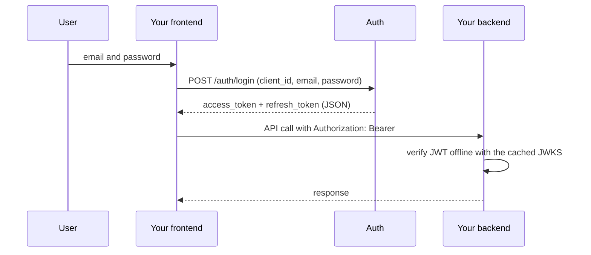
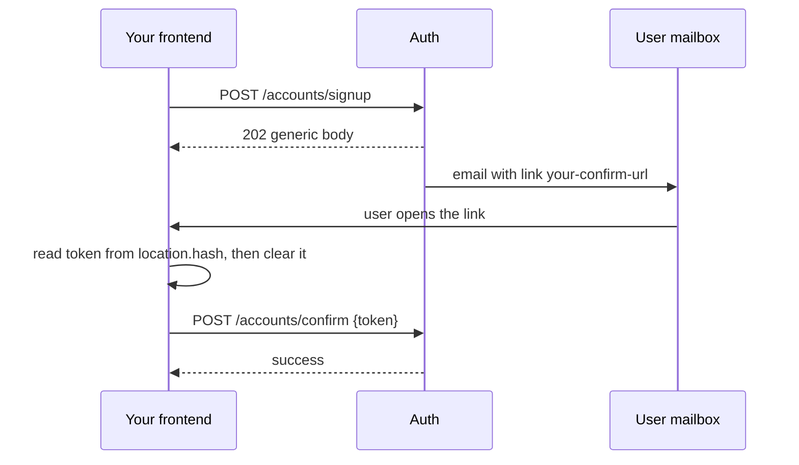
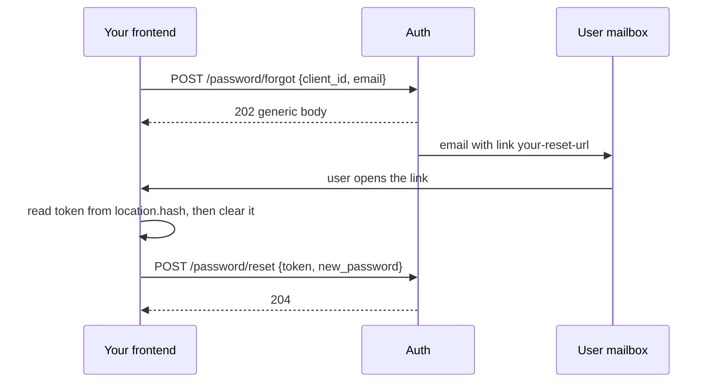

# Integrating your app with hypot Auth

hypot Auth is an API-only authentication service. Your app builds its own login, signup, confirm and reset screens, and its frontend calls Auth directly with its `client_id`. This guide is for the frontend and backend developers of consuming apps. It covers what to build, which calls to make, how to handle tokens and how to validate them in your backend.

> **Status: draft contract, built in parallel with the implementation.**
> Only part of the API exists today. Check the status of every endpoint before you build against it.
> The exact paths, bodies and error codes live in [`api-contract.md`](./api-contract.md). The authoritative OpenAPI will be generated from code in U19.

## Endpoint status

| Endpoint | Status |
|----------|--------|
| `GET /.well-known/jwks.json` | IMPLEMENTED |
| `POST /api/v1/accounts/signup` | IMPLEMENTED (no rate limits and no browser CORS yet) |
| `POST /api/v1/accounts/resend-confirmation` | IMPLEMENTED (no rate limits and no browser CORS yet) |
| `GET /api/v1/accounts/confirm?token=` | IMPLEMENTED, BEING REPLACED. Do not build against it. |
| `POST /api/v1/accounts/confirm` | PLANNED |
| `POST /api/v1/auth/login` | PLANNED |
| `POST /api/v1/auth/refresh` | PLANNED |
| `POST /api/v1/auth/logout` | PLANNED |
| `GET /api/v1/me` | PLANNED |
| `POST /api/v1/password/forgot` | PLANNED |
| `POST /api/v1/password/reset` | PLANNED |
| `POST /api/v1/password/change` | PLANNED |
| `GET /`, `GET /health` | IMPLEMENTED (operational, not part of your integration) |

Two things work differently today and will change:

- Confirmation emails currently link to Auth's `GET` confirm endpoint. After the change they link to **your** confirm screen as `<email_confirmation_url>#token=<token>`.
- Browser CORS is not yet enabled on the account routes. Until it ships you can test signup and resend only from a server or a tool such as curl.

## Quick path

1. Ask the operator to register your app (see [Onboarding](#onboarding)). You receive a `client_id` and a JWKS URL.
2. Build five screens: signup, confirm, login, forgot password and reset password.
3. Call Auth from the browser. Keep the access token in memory and serialize refreshes.
4. In your backend, verify access tokens offline against the JWKS (see [Validating access tokens](#validating-access-tokens-in-your-backend)).

## Mental model

| Topic | What it means for you |
|-------|-----------------------|
| API only | Auth serves no pages, no redirects and no cookies. Every screen is yours. |
| Direct calls | Your frontend calls Auth with your `client_id`. Your backend only validates tokens. |
| Passwords | They go from the browser to Auth. Your backend never sees them. |
| Accounts per app | `(app, email)` is unique. The same email in two apps is two independent accounts with independent passwords. |
| No SSO | A session in app A means nothing to app B. A token for A is rejected by B because `aud` differs. |
| Tokens | Login returns a 1-hour access token (RS256 JWT) and an opaque refresh token. Both arrive in the JSON body. |
| Sessions | One login is one session. Refresh tokens rotate on every use. A session lasts at most 30 days. |



## Onboarding

Apps are registered by an operator through the CLI. There is no HTTP endpoint for it. Give the operator:

| Item | Rule |
|------|------|
| Name | Display name, also used in emails. |
| Allowed origins | Every origin your frontend runs on. Origin only: `https://app.example` or `https://app.example:8443`. No path, no trailing slash, no wildcard, no `null`. `http` is accepted only for `localhost` and `127.0.0.1` outside production. |
| `email_confirmation_url` | Your confirm screen, for example `https://app.example/confirm`. REQUIRED. |
| `password_reset_url` | Your reset screen, for example `https://app.example/reset`. REQUIRED. |
| Optional | Email template content and a custom from address. |

Rules for the two URLs: absolute, `https` (or `http` for localhost outside production), no userinfo, **no fragment** (Auth appends `#token=...`). Auth takes them only from the app record, never from a request. Without both URLs your app cannot use signup, resend or password reset.

You receive:

- `client_id`: public, format `app_` plus 32 lowercase hex characters. It is not a secret.
- The issuer string and the JWKS URL (`<issuer>/.well-known/jwks.json`) for your backend configuration.

### Origin binding

A browser request carries an `Origin` header. Auth allows it only when that origin is in the allowed origins of **the app named by the request's `client_id`**. Being a registered origin of some other app is not enough.

| Request | Which app is checked |
|---------|----------------------|
| Login, refresh, logout, signup, resend, forgot | The `client_id` in the body |
| Confirm, reset | The app that owns the token in the body |
| `/me`, change password | The `aud` of the access token |

Consequences:

- Add every origin you use, including staging and local development. Changes take up to 30 seconds to apply.
- The origin of your `email_confirmation_url` and `password_reset_url` must be in your allowed origins, or your confirm and reset screens cannot call Auth from the browser. Auth does not cross-check this at registration, so verify it with the operator.
- A mismatch returns no CORS headers and an error body. See [Errors and limits](#errors-and-limits).
- Requests without `Origin` (native apps, servers) skip the binding. Rate limits still apply.
- Auth never sends `Access-Control-Allow-Credentials` and never sets cookies. Do not use `credentials: 'include'`.

## Flows

All calls are JSON (`Content-Type: application/json`) to `https://<auth-host>/api/v1/...`. Examples use `client_id` `app_0123456789abcdef0123456789abcdef`.

Password rules, for signup, reset and change: at least 8 characters, at most 72 UTF-8 **bytes**, no NUL character. Show the byte limit in your UI if you allow non-ASCII passwords.

### Signup and confirmation

Status: signup and resend IMPLEMENTED, confirm by POST PLANNED.



1. Signup:

```http
POST /api/v1/accounts/signup
{ "client_id": "app_0123456789abcdef0123456789abcdef", "email": "ana@example.com", "password": "correct horse" }
```

```http
202 Accepted
{ "message": "If this address can be registered, a confirmation email is on its way." }
```

The answer is identical for a new address and for one that already exists. For an existing address the owner receives an "account exists" notice with a link to your `password_reset_url` and no token. Show a neutral screen such as "Check your inbox". Never say whether the address was already registered.

2. The email link is `<email_confirmation_url>#token=<token>`. The token is in the fragment, so it never reaches servers, logs or `Referer` headers, and a mail scanner that fetches the link confirms nothing. It is valid for 24 hours and works once.

3. Your confirm screen reads the token, removes it from the URL and posts it:

```js
const params = new URLSearchParams(location.hash.slice(1));
const token = params.get('token');
history.replaceState(null, '', location.pathname + location.search); // do this before loading third-party scripts
```

```http
POST /api/v1/accounts/confirm
{ "token": "<token>" }
```

On success the account is confirmed and a welcome email is sent. No tokens are issued: send the user to your login screen.

| Case | Response | What to show |
|------|----------|--------------|
| Invalid input (bad email, short or too long password, NUL) | `400` with a validation code | Field errors |
| Unknown or inactive `client_id`, or origin not bound to the app | `400 invalid_client` | A configuration error. This is a bug in your setup, not a user problem. |
| App has no email URLs configured | `400 unconfigured_client` | Contact the operator |
| Confirm: invalid, used, expired or unknown token | `400 invalid_or_expired_link` | "This link is invalid or expired", with a resend form |
| IP rate limit (planned) | `429` with `Retry-After` | Retry later |

### Resend confirmation

Status: IMPLEMENTED.

```http
POST /api/v1/accounts/resend-confirmation
{ "client_id": "app_0123456789abcdef0123456789abcdef", "email": "ana@example.com" }
```

```http
202 Accepted
{ "message": "If an unconfirmed account exists for this address, a new confirmation email is on its way." }
```

The answer is the same whether the account does not exist, is unconfirmed or is already confirmed. A resend invalidates the previous link. Errors are as for signup. Offer this action on your login screen and on the expired-link screen, because login never tells the user that an account is unconfirmed.

### Login

Status: PLANNED.

```http
POST /api/v1/auth/login
{ "client_id": "app_0123456789abcdef0123456789abcdef", "email": "ana@example.com", "password": "correct horse" }
```

```http
200 OK
{ "access_token": "eyJ...", "token_type": "Bearer", "expires_in": 3600, "refresh_token": "Zk3..." }
```

- Emails are case-insensitive.
- There is no `Set-Cookie` header.
- Store the access token in memory and the refresh token as described in [Token handling](#token-handling).

| Case | Response |
|------|----------|
| Malformed body (missing field or non-string) | `400` validation error |
| Wrong password, unknown email, unconfirmed or locked account, blocked IP, IP rate limit, unknown or inactive `client_id`, origin not bound | `401 invalid_credentials`. One identical response for all of them. |
| Limiter store down | `503 temporarily_unavailable` |

Show one message such as "Email or password is incorrect". Do not try to infer more. If you want to help unconfirmed users, show a generic "Resend confirmation email" link.

### Refresh with rotation

Status: PLANNED.

```http
POST /api/v1/auth/refresh
{ "client_id": "app_0123456789abcdef0123456789abcdef", "refresh_token": "Zk3..." }
```

```http
200 OK
{ "access_token": "eyJ...", "token_type": "Bearer", "expires_in": 3600, "refresh_token": "Qm9..." }
```

Every refresh returns a **new** refresh token and marks the old one used. Replace the stored token immediately.

| Case | Response |
|------|----------|
| Unknown, expired, wrong-app, used or revoked token | `401 invalid_grant`, identical for all |
| Used or revoked token | Same `401`, and the whole session is revoked |

On `invalid_grant`, clear your tokens and send the user to login. Lifetimes: a session lasts 30 days from login and rotation does not extend it. A refresh token also expires after 7 days without use. Both values are assumptions that may be configurable, so read `expires_in` and treat any `invalid_grant` as "log in again".

### Logout

Status: PLANNED.

```http
POST /api/v1/auth/logout
{ "client_id": "app_0123456789abcdef0123456789abcdef", "refresh_token": "Zk3..." }
```

`204 No Content` for an active, used, expired, unknown or other-app token alike. It revokes the whole session. Always clear your local tokens, even when the call fails. The access token stays valid until its `exp` (at most 1 hour): there is no denylist.

### Get the profile (`GET /me`)

Status: PLANNED.

```http
GET /api/v1/me
Authorization: Bearer eyJ...
```

Returns the profile of the token's account: `sub`, email and confirmation state. The exact field names are not final (see the open questions in the contract). A missing, expired or invalid token, or one whose `aud` is not an active app, returns `401` with one generic error.

Your own backend does not need `/me` to authenticate users: validate the JWT locally instead.

### Forgot and reset password

Status: PLANNED.



```http
POST /api/v1/password/forgot
{ "client_id": "app_0123456789abcdef0123456789abcdef", "email": "ana@example.com" }
```

Always `202` with the same body, whether the account exists, is unconfirmed or belongs to another app. An email is sent only for a confirmed account in your app. Tell the user "If the address is registered, you will receive an email".

The reset link is `<password_reset_url>#token=<token>`, valid 1 hour, single use. A newer forgot request invalidates earlier links. Read and clear the token exactly as on the confirm screen, then:

```http
POST /api/v1/password/reset
{ "token": "<token>", "new_password": "a new long passphrase" }
```

`204 No Content`. The password is replaced and **all sessions of the account are revoked**. There is no redirect and no auto-login: send the user to your login screen.

| Case | Response |
|------|----------|
| Invalid, used, expired or superseded token | `400 invalid_or_expired_link` |
| Weak or invalid new password | `400` validation error. The token stays usable, so let the user retry. |
| IP rate limit | `429` with `Retry-After` |

### Change password

Status: PLANNED.

```http
POST /api/v1/password/change
Authorization: Bearer eyJ...
{ "current_password": "correct horse", "new_password": "a new long passphrase" }
```

`204 No Content`. **All sessions are revoked, including the caller's own.** Drop your tokens and send the user to login with the new password. The current access token stays valid until `exp`. A wrong current password gives the generic invalid-credentials error and counts as a failed login for lockout.

## Token handling

| Token | Lifetime | Where to keep it |
|-------|----------|------------------|
| Access token | 1 hour | In memory only (a module variable or app state). Never in `localStorage`. |
| Refresh token | 7 days idle, 30 days absolute | See the options below. |

Refresh shortly before `expires_in` runs out, rather than waiting for a `401` on every call.

### Refresh token storage

| Option | Survives reload | XSS exposure | Notes |
|--------|-----------------|--------------|-------|
| Memory only | No | Lowest. The attacker must run during the session. | Users log in again after every reload or new tab. Safest and simplest. |
| `sessionStorage` | Per tab | An XSS can read it and use it from anywhere until rotated or revoked. | Reasonable middle ground. |
| `localStorage` | Yes, all tabs | Same as above, and for longer. | Best UX. The attacker has up to 7 idle days or 30 absolute days, unless reuse detection catches it. |
| httpOnly cookie through your own backend | Yes | JavaScript cannot read it. | Not part of the Auth contract: Auth never sets cookies. It brings CSRF back and your backend becomes the client of Auth. Treat it as a design discussion with the Auth team. |

Rotation limits the damage: if a stolen token and the real client both use it, one of them presents a used token and the whole session is revoked. That protects you only if the stolen token is used while the real client is still active. Keep your CSP strict regardless (see the checklist).

### Serialize refreshes

**Rule: at most one refresh in flight per user, across all tabs.**

Auth has no grace window. Presenting a refresh token that was already used is treated as theft: it fails with `invalid_grant` and **revokes the whole session**, including the newly issued token. Two tabs (or two parallel requests) that refresh at the same time send the same token. One wins, the other triggers reuse detection, and the user is logged out.

```js
let inFlight = null;

export function refreshTokens() {
  // 1. One shared promise per page.
  inFlight ??= navigator.locks
    .request(`hypot-refresh:${CLIENT_ID}`, async () => {
      // 2. A lock across tabs. Re-read the stored token after acquiring it:
      //    another tab may have rotated it while we waited.
      const refreshToken = readStoredRefreshToken();
      const res = await fetch(`${AUTH_URL}/api/v1/auth/refresh`, {
        method: 'POST',
        headers: { 'Content-Type': 'application/json' },
        body: JSON.stringify({ client_id: CLIENT_ID, refresh_token: refreshToken }),
      });
      if (!res.ok) throw new Error(`refresh_failed_${res.status}`);
      const pair = await res.json();
      storeRefreshToken(pair.refresh_token); // replace before anything else
      return pair.access_token;
    })
    .finally(() => {
      inFlight = null;
    });
  return inFlight;
}
```

If tabs do not share storage (memory-only tokens), each tab owns its own session and there is nothing to coordinate.

Known edge case: if the network drops after Auth processed a refresh but before you receive the response, you still hold the old token. Retrying it counts as reuse and ends the session. Do not auto-retry a refresh that failed without an HTTP response. Treat it as "log in again" or confirm the session first with a fresh `/me` call using your current access token.

### Sessions end when

- The user logs out.
- A refresh token is reused (see above).
- The user resets or changes the password: **all** sessions of the account end.
- An operator revokes all sessions after a key compromise.
- The session reaches 30 days, or a refresh token sits unused for 7 days.

## Validating access tokens in your backend

Access tokens are RS256 JWTs. Validate them locally. You do not need to call Auth per request.

| Rule | Why |
|------|-----|
| Fetch the JWKS from **one fixed, configured URL** (`<issuer>/.well-known/jwks.json`). | Never use `jku`, `x5u` or `jwk` headers from the token: an attacker controls them. |
| Accept only `RS256`. | Blocks `none` and HS256 key-confusion attacks. |
| Require `typ: at+jwt`. | Distinguishes access tokens from other JWTs. |
| Check `iss` equals the configured issuer. | The issuer is exact, copy it from your onboarding message. |
| Check `aud` equals **your own** `client_id`. | Tokens from other apps are valid JWTs but are not for you. |
| Check `exp` (allow a few seconds of clock tolerance). | Auth itself uses 5 seconds. |
| Pick the key by `kid`. | Several keys are published during rotation. |
| Cache the JWKS and refetch on an unknown `kid`, with a cooldown. | Handles key rotation without hammering Auth. |

Auth serves the JWKS with `Cache-Control: public, max-age=300`. During rotation, the previous key stays published until all its tokens have expired, so a cache of up to 10 minutes is safe.

Tokens carry `iss`, `aud`, `sub` (the account id), `iat`, `exp` and `jti`. They carry no roles or permissions: authorization is your app's business.

```js
import { createRemoteJWKSet, jwtVerify } from 'jose';

// Fixed URL from configuration. Never derive it from a token.
const JWKS = createRemoteJWKSet(new URL(process.env.AUTH_JWKS_URL), {
  cooldownDuration: 30_000, // minimum time between refetches on an unknown kid
  cacheMaxAge: 600_000, // refetch at least every 10 minutes
});

export async function verifyAccessToken(token) {
  const { payload } = await jwtVerify(token, JWKS, {
    algorithms: ['RS256'],
    typ: 'at+jwt',
    issuer: process.env.AUTH_ISSUER,
    audience: process.env.AUTH_CLIENT_ID, // your own client_id
    clockTolerance: 5, // seconds
    requiredClaims: ['sub', 'exp'],
  });
  return payload; // payload.sub is the account id
}
```

Map any verification failure to `401` in your API. Do not leak the reason to the client.

Logout and password change do not invalidate access tokens that are already issued: they stay valid until `exp`. If you need immediate cut-off for a sensitive action, call `GET /me` or keep a short allow window of your own.

## Errors and limits

Error bodies have the shape `{ "error": "<code>", "message": "<text>" }`. Branch on `error`, never on `message`.

| Status | Code | Where | Meaning |
|--------|------|-------|---------|
| 400 | `invalid_request` | Body endpoints | Missing or non-string fields |
| 400 | `invalid_email`, `invalid_password` | Signup, reset, change | Validation failure. Safe to show to the user. |
| 400 | `invalid_client` | All body endpoints except login | Unknown or inactive `client_id`, or origin not bound to it. This is a setup bug. |
| 400 | `unconfigured_client` | Signup, resend, forgot | The app has no email URLs. |
| 400 | `invalid_or_expired_link` | Confirm, reset | Unknown, used, expired or superseded token |
| 401 | `invalid_credentials` | Login (and change password) | The generic login error |
| 401 | `invalid_grant` | Refresh | The session is gone. Log in again. |
| 401 | generic | `/me`, change | Missing, expired or bad access token |
| 429 | `rate_limited` | Signup, resend, forgot, reset | IP limit. Has `Retry-After`. |
| 503 | `temporarily_unavailable` | Credential endpoints | The limiter store is down. Retry later. |

Codes other than the ones in the first column group are defined in the design, not in the specs, and may still be adjusted before U19.

### The generic login error

Login returns the same `401` for an unknown email, a wrong password, an unconfirmed account, a locked account, a blocked IP, an IP over its limit and an unknown `client_id`. Status, body and headers are identical, and every attempt that is processed costs the same bcrypt work, so timing does not help either. This is deliberate: it stops attackers from learning which emails have accounts. Do not build UI that tries to tell these cases apart.

### Lockout (what users experience)

| Counter | Default | Effect |
|---------|---------|--------|
| 5 failures in 15 minutes from one IP for one account | configurable | That IP is blocked from that account for 15 minutes |
| 50 failures in 1 hour from any IP for one account | configurable | The account is locked for 15 minutes |

While blocked or locked, even the correct password fails with the same generic `401`. A user may therefore see "incorrect password" with the right password. Suggest "Forgot password" after a few failures.

### Rate limits and `429`

- **Login never returns `429`.** Limited logins return the generic `401`.
- Signup, resend, forgot and reset return `429` with a `Retry-After` header (seconds) when the **caller's IP** exceeds its limit. The decision depends only on the IP and the endpoint, never on the account.
- Handle `429` by disabling the submit button until `Retry-After` expires and showing a neutral message.
- Users behind a shared NAT can hit these limits together.
- Refresh, logout, confirm, `/me` and change have no IP limit in the current specs (change counts wrong passwords for lockout).

### The silent per-account email cap

Signup, resend and forgot send at most 3 emails per account per hour (default). Above that, Auth still answers the normal `202` and sends **nothing**. There is no error to detect. Your UI should say "If you do not receive an email, check your spam folder and try again later".

### `503`

If the limiter store is unavailable, credential endpoints fail closed with `503`. Retry with back-off and show a "try again later" message. Do not retry in a tight loop.

## Security checklist

- [ ] Production traffic uses `https` only, for Auth and for your app. Any `http` origin or email URL is for local development only.
- [ ] Your app sets a strict Content-Security-Policy (no `unsafe-inline` scripts, an allowlist of script sources). An XSS in your app can read the password field and any stored token.
- [ ] Never log tokens, passwords or full URLs containing `#token=`. This includes error trackers, analytics and session replay tools.
- [ ] Load no third-party scripts on the confirm and reset screens before you have read the token and cleared it.
- [ ] Read `#token`, then immediately run `history.replaceState` to remove it from the URL.
- [ ] Keep the access token in memory. Pick the refresh token storage deliberately (see the table above).
- [ ] Serialize refreshes with a shared promise and `navigator.locks`.
- [ ] Do not use `credentials: 'include'`. Auth sets no cookies.
- [ ] On `invalid_grant` or after logout, clear all tokens and caches of user data.
- [ ] Backend: JWKS from a fixed URL, `RS256` only, `typ`, `iss`, `aud` equal to your `client_id`, `exp`.
- [ ] Backend: never trust `jku`, `x5u` or an embedded `jwk`.
- [ ] Backend: do not use `sub` from an unverified token and do not put a token in a URL query string.
- [ ] Show the same neutral messages as Auth does. Do not add UI that reveals whether an email exists.
- [ ] Register every origin you use (including staging) and confirm the origins of your email URLs are included.

## Next step

Read [`api-contract.md`](./api-contract.md) for the per-endpoint contract and the list of open questions. Report any difference between this guide and the running service: it is a bug in one of them.
